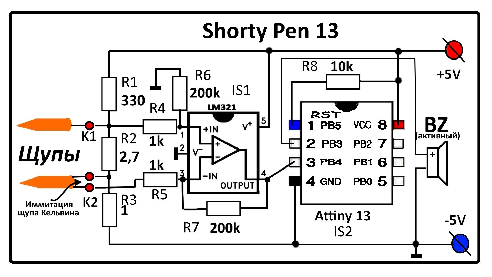

# Shorty Pen (поиск КЗ, прозвонка и тп) - Проекты - Arduino.ru

> пост от svm 14 дек. 2024

Достаточно полезная приблуда при поиске неисправностей в печатных платах.
Ссылка на автора: [Shorty - short circuit finder](https://hackaday.io/project/3635-shorty-short-circuit-finder)

Мой вариант:


```arduino
//https://radioparty.ru/prog-avr/program-c/462-lesson-74hc164
unsigned int volt;
int main(void){
DDRB   |= (1 << PB3)|(0 << PB4);
ADMUX  |= (2 << MUX0);                // Вход ADC2 
ADCSRA |= (1 << ADEN)                 // Разрешение АЦП
       |(1 << ADPS2)|(1 << ADPS1);    // Предделитель на 64

	while(1) {
digitalWrite(3, HIGH);
ADCSRA |= (1 << ADSC);                // Начинаем преобразование
while  (ADCSRA & (1 << ADSC)){}       // Ждем завершения преобразования
volt = ((unsigned long)ADC*2)+1;
delay(8);                             //время пика (по вкусу)
digitalWrite(3, LOW);
delay(volt);  
}}
```

Внешний вид:


Подробности:

[Пробник КЗ и плохих контактов ( Shorty Pen) | Сами с руками | Дзен](https://dzen.ru/video/watch/6751c54c9f6d89048ecbf06c)

[https://dzen.ru/media/id/625aee20a9cf101a646233e7/shorty-pen-132-675d9264ce41010447f18232](https://dzen.ru/media/id/625aee20a9cf101a646233e7/shorty-pen-132-675d9264ce41010447f18232)

А Вы сравните конечный вариант этого устройства, и мой вариант за пару сотен рублей. Хотя конечно я не могу измерить сопротивление в 0,1 миллиом, но на слух различаю.

Чем можно заменить LM321?
Это самый простой даже не рэйл-ту-рэйл. Любым что есть под рукой с 5 вольтовым питанием.
